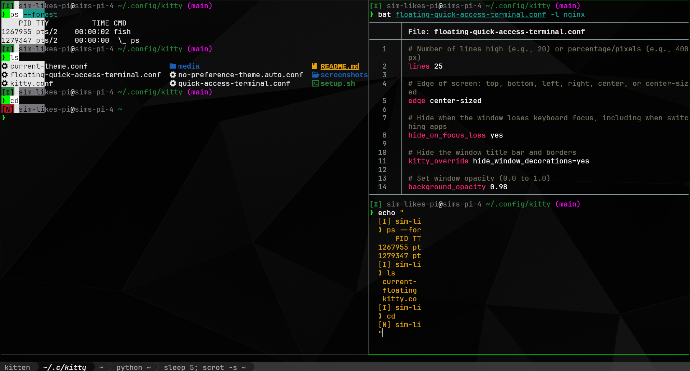

# My awesome Kitty configuration

It's my Kitty configuration, and it's awesome!

> [!NOTE]
> You'll notice that there are no actual files in media/,
> jand that's because I can't legally put this [HDQwalls image](https://hdqwalls.com/dark-abstract-black-minimal-4k-wallpaper)
> into this repo.

Instead, just run `./setup.sh`; it will automatically download the image for you.

## Installation

Easy peasy. If you're wanting to use this config
you should probably already know how to do this.

## Screenshots

